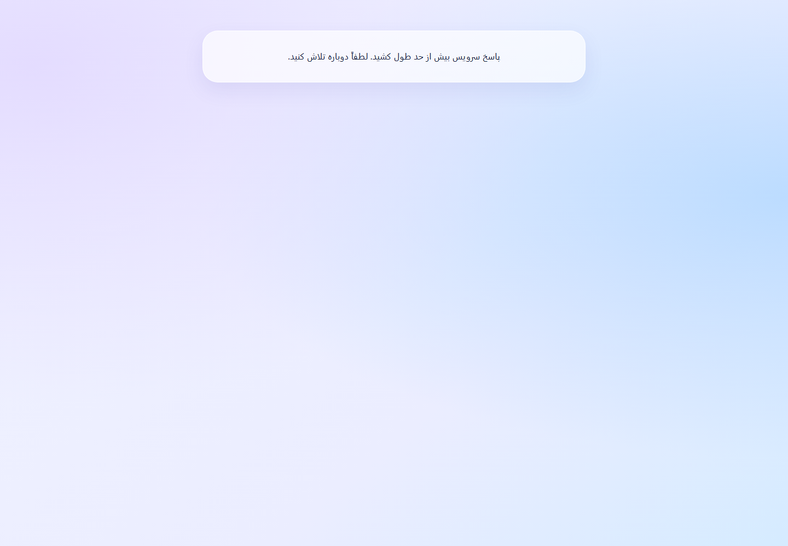
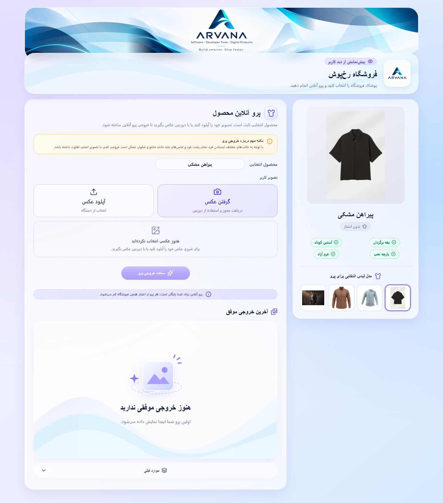

# گزارش پایداری شبکهٔ رخ‌پوش

تاریخ: 2026-11-02. مبنا: 37ffb59ba4a1659f0d11854e448cd9c524f270e3. شاخهٔ تحویل: codex/network-resilience-20261102.
این سند نتایج اعتبارسنجی سورس را پیش از انتشار ثبت می‌کند. شناسهٔ دقیق Push و انتشار و تطبیق داده‌های زنده در /srv/rookhposh-dash/ops/network-release-results.json و network-release-production-migration.json ثبت می‌شود؛ این دو سند عملیاتی مرجع نتیجهٔ استقرارند.

## نتیجه و علت ریشه‌ای

دو علت مستقل بازتولید و اصلاح شدند. پاسخ عمومی محصول، عکس‌های Base64، بنر، لوگو و داده‌های غیرضروری کاتالوگ را در یک JSON بزرگ حمل می‌کرد. در Production، پاسخ سالم HTTP 200 برابر 3,800,980 بایت بود؛ تنها بنر 2,020,566 نویسهٔ Inline داشت. پاسخ نمونهٔ کنترل‌شده 3,569,186 بایت بود. Axios پس از 12000 ms دریافت بدنه را قطع می‌کرد؛ هدر 200 بسیار زودتر رسیده بود. PublicProduct در نبود داده، فقط پیام Timeout را رندر می‌کرد و Retry نداشت. بنابراین تصویرِ خطا، اثبات خرابی AI، CORS یا Gateway نبود.

علت دوم، کمبود ظرفیت اسمی Pool نبود: create پس از Commit، در حالی که اتصال اول را نگه می‌داشت، برای raw(id) اتصال دوم می‌خواست. زیر بار 20 کاربر، هر 10 اتصال Pool در حالت Sleep قرض گرفته شده بودند؛ 13 Job ثبت‌شده در Validating مانده بود و تراکنش باز صفر بود. Health در 7.546 ms پاسخ 200 داد، ولی خواندن فروشگاه تا مهلت 2001.783 ms هیچ هدر پاسخی نداشت. استفادهٔ مجدد از همان اتصال، چرخهٔ انتظار را حذف کرد. اندازهٔ Pool همچنان 10 است.

## درخواست‌ها و اصلاحات

- GET /api/stores/:slug قرارداد قبلی را نگه می‌دارد. گزینهٔ view=page و productId برای صفحهٔ محصول، فقط متادیتای لازم و ارجاع تصاویر عمومی را می‌دهد؛ در Fixture، JSON جدید 1169 بایت است، 100.0% کمتر.
- GET /api/stores/:slug/media/banner و /logo و /products/:productId/:index فقط تصویر منتشرشدهٔ همان فروشگاه را می‌خوانند. فایل اصلی تغییر نمی‌کند. نسخهٔ نمایشی با عرض محدود و WebP بدون افت کیفیتِ کدگذاری ساخته می‌شود؛ بدون پشتیبانی WebP، اصل فایل برمی‌گردد. این مسیر هیچ URL خارجی یا فایل خصوصی پرو را واکشی نمی‌کند.
- انتشار محصول و فروشگاه در هر خواندن تصویر، حتی پاسخ 304، دوباره بررسی می‌شود. نسخهٔ قدیمی یا محصول غیرفعال 404 است. متادیتا no-store است. تصاویر عمومی ETag و public, no-cache, must-revalidate و Vary: Origin, Accept دارند. کش حافظه 24 MiB، تبدیل هم‌زمان 2 و صف تبدیل محدود است.
- usePublicStore دادهٔ موفق را هنگام اختلال موقت نگه می‌دارد و فقط پاسخ قطعی نامعتبر، مانند 404، آن را حذف می‌کند. جابه‌جایی مسیر، درخواست قبلی را Abort می‌کند. خطای تاریخچه، اعتبار یا یک تصویر، محصول را مخفی نمی‌کند.
- HTML اولیه یک نمای خوانا و امکان بارگذاری مجدد دارد؛ بعد از راه‌اندازی React، Skeleton هم‌اندازهٔ بخش‌های اصلی، خطای قابل‌بازیابی و Loading مستقل استفاده می‌شود. انیمیشن‌ها reduced-motion را رعایت می‌کنند.
- چیدمان پنل‌ها Lazy شد. فایل اصلی JavaScript از 269.41 kB به 241.16 kB رسید (10.5% کاهش). طراحی تأییدشده، دوربین، فرم، تاریخچه، Progress و دکمه‌ها حفظ شدند.

## Timeout و Retry

| درخواست | رفتار نهایی |
|---|---|
| خواندن سریع متادیتا | Timeout همان 12000 ms؛ حداکثر دو Retry خودکار |
| تصویر خصوصی و دانلود | Timeout مستقل 300000 ms؛ خطای فایل و بازیابی مستقل |
| POST ایجاد Job | پذیرش HTTP مستقل 60000 ms؛ Timeout به معنی شکست AI نیست |
| GETهای قابل Retry | Backoff حدود 400 و 800 ms با Jitter، رعایت Retry-After، توقف در Abort و خطای قطعی |
| Retry-After طولانی | انتظار مخفی بی‌پایان ایجاد نمی‌شود؛ دکمه تا پایان مهلت اعلام‌شده غیرفعال است |
| پیگیری Job | یک زنجیرهٔ لغوشونده؛ 500، 1000 و حداکثر 2000 ms در تب فعال، 8000 ms در تب پنهان؛ خطاها تا 30000 ms Backoff می‌گیرند |
| 401/403/404 قطعی Job | Polling خودکار متوقف؛ پیام و پیگیری مجدد دستی، بدون ایجاد Job تازه |
| POST پرو، اعتبار و پرداخت | Retry عمومی خودکار ندارند؛ درخواست نامعلوم فقط با همان کلید و payload و اقدام صریح کاربر قابل بازپخش است |

Offline واقعی جداگانه نمایش داده می‌شود. Online شدن، خواندن بخش‌های ناموفق و پیگیری همان عملیات را بازیابی می‌کند. خطاهای 400، 401، 403، 404، 429، 500، 502، 503 و 504 به‌صورت متمایز آزموده شدند. خطای موقت، عکس انتخابی یا آخرین خروجی موفق را پاک نمی‌کند.

## مقایسهٔ شبکه

Chrome 156 روی Windows با Playwright 1.64.1، مبدأ HTTP محلی از طریق تونل SSH با کلید میزبان تأییدشده. هر پروفایل یک اجرا با کش سرد مرورگر دارد؛ در اولین پروفایل نسخهٔ نهایی، کش تصویر سرور هم تازه است. SDK پیامک/پوش و فونت خارجی در آزمایش مسدود بودند. Latency / Download: Fast4G برابر 50 ms / 4 Mbps، Slow4G برابر 150 ms / 1.6 Mbps، Slow3G برابر 400 ms / 400 Kbps، HighLatency برابر 1000 ms / 1.6 Mbps. DelayedAPI اولین پاسخ را 14 ثانیه عقب می‌اندازد.

| پروفایل | قبل | بعد: زمان رسیدن به محصول قابل استفاده | وضعیت |
|---|---|---|---|
| Fast4G | 10333 ms | 3058 ms؛ قابل استفاده | PASS |
| Slow4G | ناموفق؛ خطا در 16698 ms | 4573 ms؛ قابل استفاده | PASS |
| Slow3G | ناموفق؛ خطا در 24856 ms | 14125 ms؛ قابل استفاده | PASS |
| HighLatency | ناموفق؛ خطا در 21022 ms | 10973 ms؛ قابل استفاده | PASS |
| DelayedAPI | ناموفق؛ خطا در 13599 ms | 15285 ms؛ قابل استفاده | PASS |

در Fast4G، زمان محتوای قابل استفاده 70.4% کم شد. حجم درخواست‌های کامل‌شده از 4,156,194 به 1,026,278 بایت رسید (75.3% کاهش). تعداد درخواست‌ها از 32 به 46 افزایش یافت؛ علت، جدا شدن فایل‌های قابل کش از JSON و بارگیری مستقل ماژول‌هاست. کاهش تعداد خام درخواست‌ها ادعا نمی‌شود؛ Retryهای تکراری و بی‌مهار حذف شده‌اند.

| نسخهٔ نهایی | FCP ms | LCP ms | TTFB سند ms | CLS | درخواست | بایت درخواست‌های کامل‌شده |
|---|---|---|---|---|---|---|
| Fast4G | 1060 | 5616 | 113.6 | 0.01660 | 46 | 1,026,278 |
| Slow4G | 1548 | 7204 | 87.6 | 0.01660 | 46 | 1,026,277 |
| Slow3G | 5128 | 24680 | 93.6 | 0.01660 | 46 | 1,026,277 |
| HighLatency | 3296 | 14372 | 106.7 | 0.01660 | 46 | 1,026,277 |
| DelayedAPI | 944 | 15248 | 116.5 | 0.00009 | 43 | 523,126 |

FCP شامل نمای اولیهٔ بارگذاری است و با زمان آماده‌شدن محصول یکی نیست. LCP در Slow3G برابر 24680 ms است، در حالی که فرم و محصول در 14125 ms قابل استفاده شده‌اند. عکس‌های تکمیلی می‌توانند دیرتر برسند. LCP صفحات خطای نسخهٔ قبلی و بایت پاسخ‌های قطع‌شده، مبنای ادعای بهبود محتوای واقعی نیستند. DNS و TLS در تونل محلی جداگانه قابل اندازه‌گیری نبودند؛ TLS Production مستقل در انتشار بررسی می‌شود. INP و p99 معتبر در این مجموعه موجود نیست.

## آزمون‌ها و امنیت

- 40 سناریوی کامل شبکه در 1440 و 390 پیکسل: PASS. دو سناریوی تکمیلی عکس بزرگ، دو سناریوی مجوز معطل دوربین و دو سناریوی پنل فروشنده نیز جداگانه PASS شدند؛ مجموع 46 سناریوی متمایز شبکه/بازیابی.
- عکس JPEG آزمایشی بزرگ‌تر از 1 MB در Slow3G، در هر دو اندازه ارسال شد؛ یک Job، یک مصرف فروشنده، هزینهٔ صفر کاربر و دانلودِ برابر با فایل اصلی تأیید شد.
- رگرسیون موجود: کاتالوگ در 1440، 1280، 1024، 768، 390 و 360 پیکسل، تاریخچهٔ صفحه‌بندی‌شده، مالکیت در IP یکسان، دانلود جدید و قدیمی، استایل مدیریت و گردش پرو بررسی شد. از 14 سناریوی اولیه، اشکال فوکوس دوربین پیدا شد؛ پس از اصلاح، هر دو سناریوی عکاسی/تعویض دوربین دوباره PASS شدند. تست منتظر مجوز، علت این Race را مستقل پوشش می‌دهد.
- دکمهٔ دوربین در انتظار مجوز و پس از بستن پنجره، برای بازگشت فوکوس قابل تمرکز است ولی aria-disabled و guard اجازهٔ شروع مجدد نمی‌دهند. منطق Stream، ضبط و توقف دوربین تغییر نکرد.
- پنل فروشنده با دادهٔ واقعی Fixture باز شد، پس از بازدید عمومی استایلش حفظ شد و دسترسی فروشندهٔ احرازشده به API ادمین 403 ماند.
- اسکن Build در برابر مقادیر واقعی محرمانهٔ تنظیمات سرور با طول حداقل 6، روی 95 فایل PASS بود. هیچ مقدار محرمانه در گزارش یا آرتیفکت ثبت نشده است.
- بازبینی امنیتی مسیرهای تغییرکرده، دسترسی مالک، ورودی‌ها، SSRF، محدودیت تبدیل تصویر، کش، CSRF، لغو درخواست، کلید تکرار و افشای لاگ انجام شد. تست‌های مرتبط پایگاه داده و مرز دسترسی PASS هستند.

## محدودیت‌ها

Firefox 132.0.1 واقعی، دو تولید با سرویس کنترل‌شده، نمایش نتیجه، تاریخچه و دانلود واقعیِ فایل اصلی را گذراند. فرمان BiDi برای بارگذاری مجدد و سپس session.new در اجرای بعدی Timeout شد؛ اعتبارسنجی کامل خودکار Firefox، BLOCKED است. Safari و دستگاه فیزیکی iOS/Android در محیط نبودند. نتایج Chrome موبایل، شبیه‌سازی مرورگر هستند. برای این محدودیت‌ها PASS کامل اعلام نمی‌شود.

اعداد آزمایشگاهی SLO تولید نیستند. کیفیت معنایی و زمان زندهٔ AI بدون فراخوانی هزینه‌دار آزموده نشده‌اند. برای عکس‌های عمومی کوچک، WebP بدون افت کیفیت می‌تواند از JPEG اصلی بزرگ‌تر باشد؛ بهبود گزارش‌شده مربوط به حجم کل صفحه و جداسازی متادیتاست. هیچ نسخهٔ اصلی حذف یا بازنویسی نشده است.

## فایل‌ها و شواهد

[داده‌های اندازه‌گیری](artifacts/network-performance/measurements.json) · [گزارش سرعت پرو](ROOKHPOSH-TRYON-PERFORMANCE-REPORT.md) · [Release Gate](ROOKHPOSH-PERFORMANCE-RELEASE-GATE.md)

فایل‌های ایجاد یا اصلاح‌شده در این مأموریت:

- ROOKHPOSH-NETWORK-RESILIENCE-REPORT.md
- ROOKHPOSH-PERFORMANCE-RELEASE-GATE.md
- ROOKHPOSH-TRYON-PERFORMANCE-REPORT.md
- backend/src/controllers/storeController.js
- backend/src/repositories/dbStore.js
- backend/src/routes/storeRoutes.js
- backend/src/services/publicMedia.js
- backend/src/tryon/jobStore.js
- backend/src/tryon/performance.js
- backend/src/tryon/routes.js
- backend/src/tryon/worker.js
- backend/test/helpers/networkE2EServer.js
- backend/test/integration/network.test.js
- backend/test/publicMedia.test.js
- e2e/firefox-network-smoke.cjs
- e2e/network-benchmark.cjs
- e2e/network-resilience.spec.cjs
- frontend/index.html
- frontend/public/startup.js
- frontend/src/components/public/PublicImage.jsx
- frontend/src/components/public/PublicPageState.jsx
- frontend/src/components/public/PublicStoreHero.jsx
- frontend/src/components/public/SelectedProductPanel.jsx
- frontend/src/components/public/public-page.css
- frontend/src/components/tryon/PrivateImage.jsx
- frontend/src/components/ui/ErrorBoundary.jsx
- frontend/src/hooks/usePublicStore.js
- frontend/src/hooks/useTryon.js
- frontend/src/hooks/useTryonConnection.js
- frontend/src/pages/PublicProduct.jsx
- frontend/src/pages/PublicStore.jsx
- frontend/src/routes/App.jsx
- frontend/src/services/apiClient.js
- frontend/src/services/publicStoreApi.js
- frontend/src/services/tryonApi.js
- frontend/src/utils/proOutput.js
- frontend/src/utils/publicMedia.js
- frontend/src/utils/requestPolicy.js
- frontend/src/utils/tryonTiming.js
- frontend/test/requestPolicy.test.mjs
- package.json
- playwright.network.config.cjs

تصاویر شاهد و measurements.json در artifacts/network-performance نیز به سورس تحویل اضافه شده‌اند.
