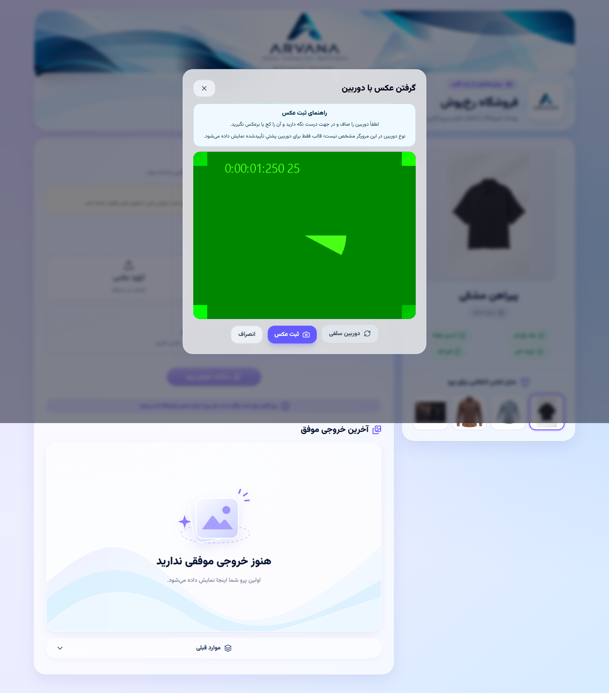

# گزارش عملکرد مسیر پرو مجازی رخ‌پوش

مبنا: 37ffb59ba4a1659f0d11854e448cd9c524f270e3؛ شاخهٔ تحویل: codex/network-resilience-20261102. تاریخ: 2026-11-02. همهٔ اعداد این گزارش آزمایشگاهی‌اند و از measurements.json قابل بررسی هستند.

## معماری و مسیر واقعی

    Browser → آماده‌سازی فعلی عکس → POST /api/stores/:slug/products/:id/pro/jobs
      → همان احراز هویت/نشست مهمان و قوانین اولین استفاده
      → اعتبارسنجی تصویر و ذخیرهٔ خصوصی → تراکنش رزرو اعتبار فروشنده
      → Job پایدار در MariaDB → Worker سریال موجود
      → خواندن فایل‌ها و تنظیمات → همان Adapter و Provider و سیاست Failover
      → اعتبارسنجی/ذخیرهٔ خصوصی خروجی → ثبت تراکنشی نتیجه و مصرف
      → GET وضعیت با Polling → GET تصویر با کنترل مالک → Blob و نمایش/دانلود

Frontend همان React/JavaScript و React Router با Axios است؛ Backend همان Node/Express و mysql2/MariaDB است. صف جدید، SSE یا WebSocket، ORM جدید و Storage عمومی برای عکس کاربران اضافه نشده است. اندازهٔ Pool، جداول و قراردادهای قدیمی حفظ شده‌اند.

## گلوگاه‌ها و اصلاحات

1. اتصال تو در توی Pool می‌توانست پذیرش Job و خواندن فروشگاه را متوقف کند. raw و lookupهای پس از Rollback از اتصالِ در اختیار همان تراکنش استفاده می‌کنند؛ SQL رزرو، آزادسازی و ثبت مصرف عوض نشده است.
2. Worker بعد از هر موفقیت، یک ثانیه بی‌دلیل منتظر می‌ماند. اکنون بعد از موفقیت، Job بعدی را بدون آن فاصله برمی‌دارد؛ اجرای سرویس‌ها همچنان سریال است و پس از خطا/بیکاری و در Cooldown همان انتظار حفظ می‌شود.
3. نخستین Poll قدیمی 1200 ms و فاصله‌های بعدی 2000 ms بودند. زنجیرهٔ جدید یک درخواست در لحظه دارد؛ ابتدا 500 ms، سپس 1000 و حداکثر 2000 ms. تب پنهان و خطا Backoff مستقل دارند. تکمیل یا خطای قطعی دسترسی، حلقه را متوقف می‌کند.
4. پاسخ POST گم‌شده، با request_key بازیابی می‌شود. در نبود قطعیت، همان payload آماده و کلید حفظ می‌شود؛ فقط اقدام دستی پس از lookup می‌تواند آن را بازپخش کند. Retry یک Job نیز کلید نامعلوم قبلی را تا تأیید پذیرش نگه می‌دارد. Retry اعتبارسنجی تصویر را تکرار نمی‌کند و فایل‌های همان Job را مصرف می‌کند.
5. فایل‌های خروجی دیگر Timeout عمومی 12 ثانیه‌ای ندارند؛ Timeout انتقال 300 ثانیه، بازیابی مستقل و اعتبارسنجی محتوای دانلود حفظ شده است.
6. Server-Timing و لاگ عددی محدود برای پذیرش، خواندن ورودی، تنظیمات، Provider Round-Trip، ذخیره و ثبت نتیجه اضافه شد. نام Job و زمان‌ها ثبت می‌شوند؛ عکس، Base64، Cookie، کلید و متن خصوصی درخواست وارد لاگ نمی‌شوند. شکست مشاهده‌گر زمان‌سنجی، Job پولی را خراب نمی‌کند.

خواندن دوبارهٔ فایل برای بررسی یکپارچگی حفظ شد؛ هزینهٔ آن در آزمون چند میلی‌ثانیه بود. برای حذف این کنترل امنیتی یا تغییر Keep-Alive سرویس AI شواهد کافی وجود نداشت. Prompt، مدل، فرمت و کیفیت ورودی/خروجی، Adapter، Timeoutهای Provider، ترتیب سرویس‌ها و سیاست Failover تغییر نکردند.

## روش اندازه‌گیری و حدود تفسیر

پنج نمونه برای هر نسخه، در تب پیش‌زمینهٔ Chrome 156، با یک تصویر ورودی، یک فایل خروجی اصلی و Provider کنترل‌شدهٔ 200 ms اجرا شد. SHA-256 ورودی ارسال‌شده در هر ده نمونه یکسان است: 2d83700d2aebe2516c85e616080336b9e8806b18ac67d981442627602b521674. اندازهٔ ورودی 22659 بایت است. هیچ درخواست زندهٔ AI، پیامک یا پرداخت برای آزمایش ارسال نشده است.

p50 و p95 از روش nearest-rank محاسبه شده‌اند؛ با N=5، p95 همان بزرگ‌ترین نمونه است. p99 یا INP از این نمونه‌ها نتیجه‌گیری نمی‌شود. نمونهٔ پایلوت با زمان 8832 ms پنهان نشده و از مقایسهٔ نهاییِ کنترل‌شده جداست؛ اجرای نهایی تب را به پیش‌زمینه آورد و در هر پنج نمونه hidden=false ثبت کرد. پایلوت همچنین یک ECONNRESET در GET ابزار اندازه‌گیری داشت؛ فقط GETهای ابزار Retry محدود گرفتند و کل مقایسهٔ نهایی از ابتدا تکرار شد. POST ساخت پرو به‌طور خودکار تکرار نشد.

زمان کل از کلیک پذیرش قوانین تا مشاهدهٔ تصویر بارگذاری‌شده است. رویداد XHR upload.loadend زمان مشاهده‌شده در مرورگر است و روی تونل محلی معادل زمان خالص سیم شبکه نیست. شاخص آماده‌سازی قبل از تغییر، اختلاف رویدادهای ابزار است؛ نوسان آن به‌معنای بهینه‌سازی الگوریتم عکس نیست. زمان پایان Provider تا نمایش با epoch سرور و نصف RTT درخواست وضعیت هم‌تراز شده و دارای عدم قطعیت شبکه است. GET فایل، Decode و Paint داخلی به‌طور کامل تفکیک نشده‌اند.

## زمان قبل و بعد

واحد همهٔ اعداد جدول میلی‌ثانیه است؛ هر خانه p50 / p95 است.

| شاخص | قبل | بعد |
|---|---|---|
| فاصلهٔ رویداد دریافت قوانین تا مشاهدهٔ POST؛ شاخص تقریبی آماده‌سازی | 341.2 / 827.5 | 206.2 / 383.4 |
| رویداد upload.loadend در XHR؛ انتقال مشاهده‌شدهٔ مرورگر | 134.3 / 639.9 | 129.1 / 300.2 |
| دریافت، اعتبارسنجی، ذخیرهٔ ورودی و پاسخ پذیرش Backend | 348.5 / 357.6 | 327.9 / 372.5 |
| انتظار صف؛ اختلاف created_at و started_at دیتابیس | 19 / 28 | 13 / 28 |
| Provider Round-Trip Duration کنترل‌شده | 200 / 201 | 200 / 200 |
| اعتبارسنجی و ذخیرهٔ خروجی | 127.2 / 166.2 | 131.9 / 172.7 |
| ثبت نهایی و حسابداری در دیتابیس | 15.4 / 41.9 | 13.8 / 16.6 |
| GET فایل خصوصی خروجی تا پایان انتقال | 109.6 / 337.4 | 90.1 / 100.1 |
| پایان Provider تا مشاهدهٔ خروجی؛ با هم‌ترازی ساعت تقریبی | 2313 / 2414 | 1687 / 1810.5 |
| پذیرش قوانین تا مشاهدهٔ خروجی کامل؛ زمان کل | 3688 / 4381 | 2987 / 3290 |

میانهٔ زمان کل 19.0% و p95 نمونه‌ها 24.9% کم شد. این درصدها به همان مسیر آزمایشگاهی مربوط‌اند و ادعای کاهش زمان محاسبات داخلی AI نیستند. زمان Provider در هر دو نسخه حدود 200 ms بود.

تفکیک مراحل T1–T12:

| مرحله | شواهد |
|---|---|
| T1 آماده‌سازی مرورگر | زمان‌سنج آماده‌سازی نسخهٔ جدید و شاخص رویدادی قبل/بعد؛ الگوریتم فعلی بدون تغییر |
| T2 انتقال ورودی | رویداد upload.loadend؛ Slow3G با عکس بزرگ و یک POST تأیید شد |
| T3 دریافت/اعتبارسنجی Backend | api_response و Server-Timing؛ شامل ذخیره و پاسخ پذیرش |
| T4 اطلاعات و فایل‌ها | asset_metadata، input_read، garment_read و provider_settings |
| T5–T8 ساخت درخواست/اتصال/AI/دریافت | در مرز generate به‌صورت Provider Round-Trip ثبت می‌شوند؛ تفکیک زندهٔ TLS، پردازش داخلی و انتقال Provider، BLOCKED |
| T9 اعتبارسنجی و Storage | output_validation_storage و output_integrity |
| T10 ثبت نتیجه | output_persistence و db_finalize؛ تراکنش حسابداری موجود |
| T11 دریافت وضعیت و فایل | درخواست‌های واقعی مالکانه و outputTransfers |
| T12 نمایش | رویداد بارگذاری تصویر و مشاهدهٔ تصویر کامل؛ زمان Decode/Paint خالص جدا نشده است |

## بار هم‌زمان و منابع

ورودی‌ها برای 1، 5، 10 و 20 نشست مستقل آماده شدند؛ سرویس کنترل‌شده تا پذیرش درخواست‌ها پشت Gate بود و سپس آزاد شد. ستون دریافت/بررسی شامل GET و بررسی SHA فایل‌های همهٔ کاربران هم هست، پس زمان خالص Worker نیست. ستون پایان پردازشِ بعد، پیش از آن بررسی‌های کلاینت ثبت شده است.

| کاربر | قبل: دریافت و بررسی همهٔ خروجی‌ها | بعد: همان معیار | بعد: پایان پردازش‌ها | فراخوانی AI / مصرف موفق / مبلغ کاربر | وضعیت |
|---|---|---|---|---|---|
| 1 | 659 ms | 619 ms | 432 ms | 1 / 1 / 0 | PASS |
| 5 | 7214 ms | 3499 ms | 2130 ms | 5 / 5 / 0 | PASS |
| 10 | 15288 ms | 7162 ms | 4244 ms | 10 / 10 / 0 | PASS |
| 20 | Timeout پس از 30000 ms؛ Pool متوقف | 13613 ms | 8219 ms | 20 / 20 / 0 | PASS |

پیش از اصلاح در 20 کاربر، 10 اتصال قرض‌گرفته‌شده Sleep و صفر تراکنش باز دیده شد؛ API عمومی معطل ماند، در حالی که Health سالم بود. پس از اصلاح، 20 پذیرش و 20 نتیجهٔ موفق با فایل اصلی معتبر ثبت شد. SQL انتظار صف از زمان‌های همان دیتابیس محاسبه شده و در آرتیفکت موجود است.

| کاربر | CPU User مصرف‌شده | CPU System مصرف‌شده | RSS پس از دور آزمایش |
|---|---|---|---|
| 1 | 0.455 s | 0.093 s | 206.9 MiB |
| 5 | 1.587 s | 0.352 s | 234.4 MiB |
| 10 | 3.278 s | 0.811 s | 280.4 MiB |
| 20 | 6.771 s | 1.578 s | 262.4 MiB |

CPU مصرف تجمعی همان دور آزمایش و RSS یک Snapshot است؛ RSS اوج مصرف یا ظرفیت نهایی سرور نیست. این نتایج جای تست بار با Provider زنده و ترافیک واقعی را نمی‌گیرند.

## کیفیت، تاریخچه، دانلود و اعتبار

- منبع Provider، Prompt، مدل، پارامترها، modules مربوط به images/network/providers/config/identity/terms، فایل‌های schema و پیش‌پردازش مرورگر با نسخهٔ مبنا برابرند. این برابری با Git و Manifest بررسی شد؛ کلید و تنظیمات واقعی در محیط خصوصی می‌مانند.
- فایل خروجی Fixture 19346 بایت، WebP و دارای SHA-256 برابر e7e72d46337d10219219c617e2147b9829bd9c05c6d321317e651567a001c856 است. دانلود جدید، قدیمی، کند و همهٔ 36 خروجی بار هم‌زمان با این بایت‌ها مقایسه شد. فایل نمایشی یا HTML جای دانلود موفق پذیرفته نشده است.
- آخرین خروجی، بازیابی پس از Refresh، تاریخچهٔ صفحه‌بندی‌شده، مشاهده/دانلود و منع دسترسی نشست دیگر با همان IP بررسی شد. تاریخچه و فایل‌های قبلی حذف نمی‌شوند.
- در تمام دورهای بار، calls=uses=count و مبلغ کاربر صفر بود. سناریوهای گم‌شدن پاسخ، آفلاین شدن وسط پردازش و Retry، تولید و مصرف اضافه ایجاد نکردند. کسر اعتبار فقط بر اساس منطق تراکنشی موجود است.
- 21 تست یکپارچهٔ پرو شامل مرزهای دسترسی، Retry، Failover و مسیرهای شکست، 6 تست قوانین و 3 تست شبکه با MariaDB ایزوله PASS شدند. Failover زندهٔ سرویس جایگزین آزموده نشده؛ طبق خواستهٔ قبلی فقط سرویس فعلی تنظیم است.

## Build، رگرسیون و محدودیت‌ها

118 تست Backend و 95 تست Frontend PASS؛ 30 تست یکپارچه PASS؛ 46 سناریوی شبکه/بازیابی متمایز PASS؛ رگرسیون 14 سناریوی طراحی/گردش کار پس از اصلاح دوربین تکمیل شد. Build نهایی و Lint بدون خطا PASS شدند؛ چهار هشدار Fast Refresh از قبل وجود دارند. پروژه JavaScript است و Typecheck مستقل تعریف نشده است. اسکن Build برای محرمانه‌های واقعی سرور PASS بود.

Firefox واقعی بخشی از گردش خروجی و دانلود را گذراند، ولی کنترل کامل BiDi متوقف شد؛ Safari، دستگاه‌های واقعی، INP میدانی، p99 و زمان/کیفیت معنایی سرویس AI زنده BLOCKED هستند. Mock به‌تنهایی تأیید کیفیت واقعی سرویس نیست. هیچ پنهان‌کردن خطای Production یا افزایش مصنوعی درصد پیشرفت انجام نشده است.

بدون تغییر schema، Migration جدید اجرا نمی‌شود. آرشیو سورس پیش از تغییر 31,644,229 بایت و SHA-256 آن 3c6d137d7bfccbd3db28d8aa6e283c0ee2d94d831950d167b4d1f05bd6da7cbe است؛ gzip/Tar بررسی شد. در انتشار، نسخهٔ پشتیبان خصوصی تازه، Drain عملیات، تطبیق تمام داده‌ها/ساختار و فایل‌های خصوصی و روش Rollback بدون بازگرداندن مخرب دیتابیس الزامی است. نتیجهٔ زنده در اسناد عملیاتی معرفی‌شده در Release Gate ثبت می‌شود.

[اندازه‌گیری‌های خام و خلاصه](artifacts/network-performance/measurements.json) · [گزارش شبکه و فهرست فایل‌ها](ROOKHPOSH-NETWORK-RESILIENCE-REPORT.md) · [Release Gate](ROOKHPOSH-PERFORMANCE-RELEASE-GATE.md)

